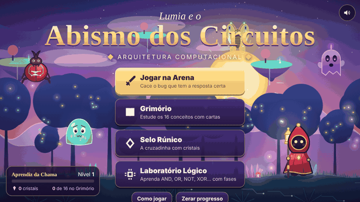
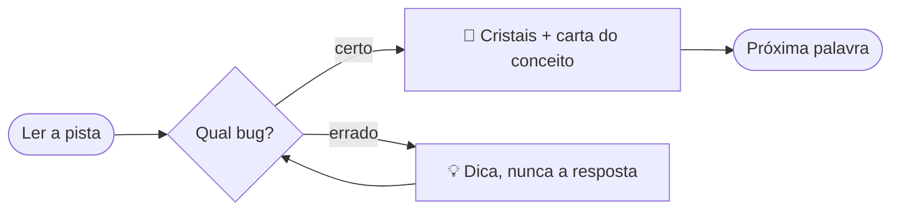
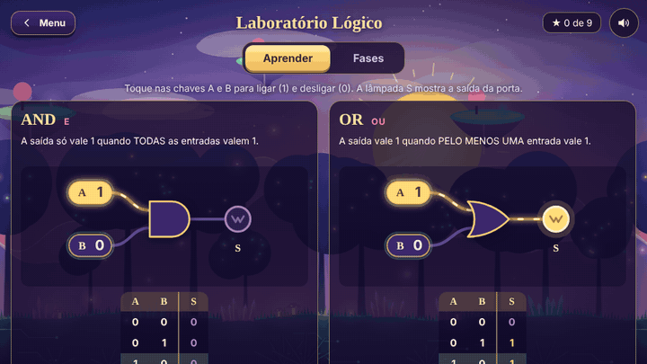
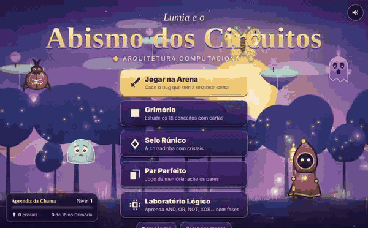
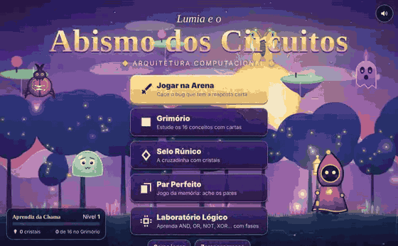
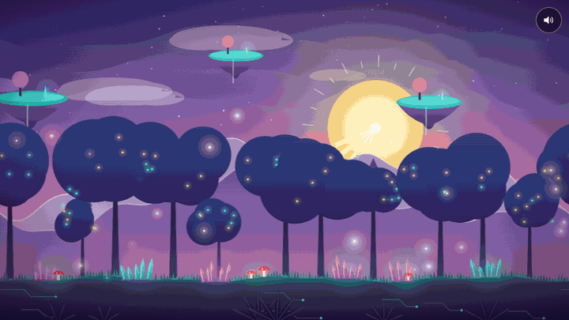

  

  

  
  
  
  
  

<h3 align="center">🔮 Um jogo de estudo de Arquitetura Computacional, com bugs para caçar, cartas para virar e circuitos para acender.</h3>

<b>ARQCOMP · Exercício 04 · Sprint 3</b>

## 🎮 Jogue

👉 **[https://kevinz138.github.io/Jogo---Arq.-Comp/](https://kevinz138.github.io/Jogo---Arq.-Comp/)**

Abre direto no navegador, no computador ou no celular. Não precisa instalar nada.

## ✨ O que tem no jogo

<table>
<tr>
<td width="50%" valign="top">

### ⚔️ Arena
Cace o **bug** que carrega o nome certo. A Lumia lança luz, o bug vira cristais e uma carta explica o conceito.

</td>
<td width="50%" valign="top">

### 📖 Grimório
Cartas que **viram** com os 16 conceitos, com filtro por categoria. Estudar aqui deixa a Arena mais fácil.

</td>
</tr>
<tr>
<td width="50%" valign="top">

### 🔷 Selo Rúnico
A **cruzadinha** com as 16 palavras, **sorteada de novo** a cada vez. Digite as letras, use **Conferir** e **Reiniciar**, ou compre letras com cristais.

</td>
<td width="50%" valign="top">

### 💡 Laboratório Lógico
**7 portas lógicas** para aprender e 3 níveis de **10 fases sorteadas**, com 8 tipos de desafio e 28 perguntas de teoria.

</td>
</tr>
<tr>
<td width="50%" valign="top">

### 🃏 Par Perfeito
Jogo da **memória**: ache os pares de conceito + descrição, ou de porta lógica + nome. Pares e posições sorteados.

</td>
<td width="50%" valign="top">

### 🎲 Tudo aleatório
Perguntas, opções, cruzadinha, circuitos e cartas **mudam a cada partida**. Não dá para decorar a ordem.

</td>
</tr>
</table>

## 🕹️ Como jogar

1. Clique em **Jogar na Arena** e escolha o modo: **Aprendiz** (não perde vida) ou **Guardiã** (3 chamas por onda).
2. Leia a **pista** no topo da tela. Cada bug carrega uma plaquinha com um nome.
3. Toque no bug certo, ou aperte as teclas **1 a 5**.
4. **Errou?** A Lumia nunca entrega a resposta: ela mostra uma **dica** mais forte a cada erro (ou aperte **H** para pedir uma).
5. **Acertou?** O bug vira cristais e abre uma carta com a explicação.
6. Botões do jogo: **Dica**, **Conferir** (lista das palavras acertadas e o contador "X de 16 palavras"), **Reiniciar** e **Pausa**.

> 🎲 **Nada de decorar:** a ordem das palavras, as opções e o **tipo de pergunta** (pista, descrição ou "quem sou eu?") são sorteados a cada partida.

## 💡 Laboratório Lógico

| Porta | Quando a saída vale 1 |
|-------|-----------------------|
| **AND** (E) | só quando **todas** as entradas valem 1 |
| **OR** (OU) | quando **pelo menos uma** entrada vale 1 |
| **NOT** (NÃO) | sempre o **contrário** da entrada |
| **NAND** | só **não** vale 1 quando todas as entradas valem 1 (AND negado) |
| **NOR** | só quando **todas** as entradas valem 0 (OR negado) |
| **XOR** | quando as entradas são **diferentes** |
| **XNOR** | quando as entradas são **iguais** |

Tem duas abas:
- **Aprender:** ligue e desligue as chaves A e B e veja a lâmpada, os fios e a tabela-verdade reagirem.
- **Fases:** 3 níveis (**Fácil**, **Médio**, **Difícil**) com **10 fases cada**. Os tipos de desafio são sorteados a cada partida e os circuitos são gerados na hora:

| Desafio | O que você faz |
|---------|----------------|
| ⚡ **Qual é a saída?** | segue os fios e descobre o valor que chega na lâmpada |
| 🧮 **Expressão** | calcula algo como `A AND (NOT B)` com os valores dados |
| 🔍 **Qual porta é essa?** | reconhece a porta pela tabela-verdade |
| 🎯 **Qual destas portas?** | escolhe a porta que dá a saída pedida para certas entradas |
| 🔌 **Ligar a lâmpada** | toca nas chaves até a lâmpada acender (ou apagar) |
| 🔢 **Contar** | diz em quantas combinações de chaves a lâmpada acende |
| 🕵️ **Porta escondida** | descobre a porta do `?` que faz a tabela inteira bater |
| 📚 **Teoria** | responde 28 perguntas (portas universais, somador de 1 bit, ULA...) |

Errou? Vêm **dicas** em 3 etapas e a última risca uma opção errada. A resposta nunca aparece. Ao acertar, a Lumia mostra o passo a passo.

## 🔷 Selo Rúnico (cruzadinha sorteada)

Cada vez que você abre o Selo com o tabuleiro vazio, um programa **monta uma cruzadinha nova** encaixando as 16 palavras em posições diferentes. O botão **Novo tabuleiro** sorteia outra quando quiser. **Conferir** marca as palavras certas e erradas, **Reiniciar** limpa as letras e o contador mostra **X de 16 palavras**.

## 🃏 Par Perfeito (jogo da memória)

- **Conceitos:** junte o nome (CPU, DMA, Cache...) com a sua descrição curta.
- **Portas lógicas:** junte o desenho da porta (ou a coluna S da tabela-verdade) com o nome dela.
- 3 níveis (6, 8 ou 10 pares nos conceitos). A cada jogo os pares e as posições são sorteados.
- **Espiar** mostra todas as cartas por um instante, mas custa 3 jogadas. No fim aparece um resumo com tudo que você juntou.

## 📖 Grimório

## 🧠 As 16 palavras e suas pistas

<b>Ver a tabela completa</b>

 

| # | Palavra | Categoria | Pista |
|---|---------|-----------|-------|
| 1 | CPU | Processador | O cérebro do computador, executa as instruções dos programas. |
| 2 | ULA | Processador | Parte da CPU que faz as contas e as operações lógicas. |
| 3 | UC (Unidade de Controle) | Processador | Parte da CPU que comanda o que cada componente deve fazer. |
| 4 | Registradores | Processador | Minúsculas memórias dentro do processador, rapidíssimas, guardam dados do momento. |
| 5 | RAM | Memória | Memória principal e volátil onde ficam os programas em uso. |
| 6 | ROM | Memória | Memória que só é lida e não perde os dados sem energia. |
| 7 | EEPROM | Memória | Memória não volátil que pode ser regravada byte a byte, sem sair da placa. |
| 8 | Flash | Memória | Memória não volátil usada em pen drives e cartões SD. |
| 9 | Cache | Memória | Memória pequena e veloz perto da CPU, guarda o que é muito usado. |
| 10 | Memória de massa (armazenamento) | Memória | Onde seus arquivos ficam de forma permanente, como no HD ou SSD. |
| 11 | DMA | Transferência | Deixa dispositivos trocarem dados com a RAM sem incomodar a CPU. |
| 12 | Address bus (barramento de endereço) | Transferência | Caminho que indica qual posição da memória será lida ou escrita. |
| 13 | Data bus (barramento de dados) | Transferência | Caminho de ida e volta por onde o conteúdo viaja entre os componentes. |
| 14 | Microcontrolador | Sistemas | Chip pequeno que junta processador, memória e portas, usado em aparelhos embarcados. |
| 15 | Dual core | Sistemas | Processador com dois núcleos trabalhando juntos. |
| 16 | Quad core | Sistemas | Processador com quatro núcleos trabalhando juntos. |

## 🗂️ Arquivos do projeto

<b>Ver a estrutura</b>

 

| Arquivo | Para que serve |
|---------|----------------|
| `index.html` | todas as telas do jogo |
| `style.css` | visual, animações das telas e responsividade |
| `dados.js` | as 16 palavras, pistas, dicas e o tabuleiro da cruzadinha |
| `arena.js` | a Arena (perguntas sorteadas, bugs, dicas, combo) |
| `portas.js` | o Laboratório Lógico (circuitos sorteados, 8 tipos de desafio) |
| `memoria.js` | o jogo da memória Par Perfeito |
| `grimorio.js` · `selo.js` | o Grimório e o Selo Rúnico (com o gerador de cruzadinhas) |
| `cenario.js` · `personagens.js` · `efeitos.js` | cenário, personagens e partículas desenhados em canvas |
| `som.js` | sons e música gerados no navegador |
| `telas.js` · `script.js` | interface, perfil salvo e laço principal |
| `assets/` | imagens animadas deste README |

Feito com 💜 para estudar Arquitetura Computacional. Sem bibliotecas: só HTML, CSS e JavaScript.

